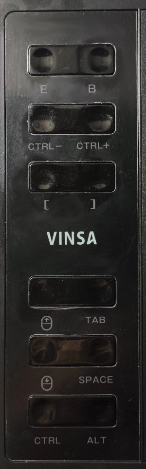

# Linux Driver for VINSA 1060 Plus Drawing Tablet (V.3.0.2)

Linux driver for the VINSA 1060 Plus drawing tablet with full pressure sensitivity and button support. Chipset: `08f2:6811`

## 🚀 Complete Code Modification for Wayland

- **Wayland Native Architecture**: Modified and optimized for **Kubuntu 26.04** running under Wayland (KWin / Libinput). It exposes three independent virtual devices (`uinput`) to avoid compositor interpretation issues.
- **System Tray Icon Integration**: Added an icon to the taskbar to indicate when the driver is active. This icon dynamically shifts (Mouse 🖱️ / Tablet 🎨) depending on the internal driver state.
- **Krita Cursor Fix**: Uses a standardized device name prefix (`Wacom...`) to force Libinput to treat the virtual injector as a real `TABLET_TOOL` digitalizer, enabling the brush circle and pressure levels in any system language.
- **Multi-language Hotkeys**: Integrates `xkbcommon` to detect the system layout at runtime. It automatically bundles an atomic burst of events with `Alt Gr` (`KEY_RIGHTALT`) if the system is in Spanish to type `[` and `]` correctly, skipping it seamlessly if the system is in English.
- **Anti-USB Flood Filtering**: Implemented an absolute event rejection filter to drop consecutive identical coordinate packets, dropping CPU overhead down.
- **Taskbar Control**: Right-clicking the taskbar icon displays a contextual menu to exit the driver cleanly.

## ✨ Features
- Fixed issue where entering the top media area would cause the cursor jump to the bottom screen.
- Full pressure support (8192 levels).
- Adjustable relative mouse speed scaling.
- Mouse/Tablet mode toggle via hardware button.
- The taskbar icon indicates Tablet or Mouse mode.   
- Custom desktop launcher integration.
- All multimedia keys in the tablet upper area perform their corresponding functions

### Buttons mapping
<table>
  <tr>
    <td>
      
    </td>
    <td>
      <ul>.
        <br></br>
        <li><strong>Button E:</strong> Erase</li>
        <li><strong>Button B:</strong> Toogle Mode (Mouse/Tablet)</li>
        <br></br>
        <li><strong>Button CTRL - :</strong> = Zoom out</li>
        <li><strong>Button CTRL + :</strong> Zoom in</li>
        <br></br>
        <li><strong>Tablet Mode</li>
          <li style="margin-left: 25px;"><strong>Button [ :</strong> Decrease brush size</li>
          <li style="margin-left: 25px;"><strong>Button ] :</strong> Increase brush size</li>
        <br></br>
        <li><strong>Mouse Mode</li>
          <li style="margin-left: 25px;"><strong>Button [ :</strong> Decrease speed mouse</li>
          <li style="margin-left: 25px;"><strong>Button ] :</strong> Increase speed mouse</li>
        <br></br>
        <li><strong>Mouse up:</strong> Scroll up</li>
        <li><strong>TAB:</strong> Toggle full screen</li>
        <br></br>
        <li><strong>Mouse down:</strong> Scroll down</li>
        <li><strong>SPACE:</strong> Space (Pan)</li>
        <br></br>
        <li><strong>CTRL:</strong> CTRL</li>
        <li><strong>ALT:</strong> ALT</li>
        <br></br>
      </ul>
    </td>
  </tr>
</table>

---

## 🛠️ System Requirements

Before compiling, you need to install the required system libraries for **GTK3 interface loop**, **SVG rendering libraries**, and **XKB layout layout context engine**:

```bash
sudo apt update
sudo apt install libxkbcommon-dev libgtk-3-dev pkg-config build-essential
```

The gettext development tools are only needed when updating or compiling translations:

```bash
sudo apt install gettext
```

---

## 📦 Installation

Make sure you have the Rust toolchain installed on your computer.

### 1. Clone & Build
```bash
# Clone the repository
git clone https://github.com
cd vinsa-1060-driver/driver

# Build the driver binary in release mode
cargo build --release
```

### 2. Configure Udev Rules (Crucial for Non-Sudo execution)
To be able to run the driver as a standard desktop user without root access, create the local rule file:

```bash
sudo nano /etc/udev/rules.d/99-vinsa-tablet.rules
```

Paste the following content inside:

```udev
# VINSA USB Interface permission
SUBSYSTEM=="usb", ATTR{idVendor}=="08f2", ATTR{idProduct}=="6811", MODE="0666"
# Input subsystem permissions
SUBSYSTEM=="input", GROUP="input", MODE="0666"
# Virtual Device injector permission
KERNEL=="uinput", MODE="0666", GROUP="input"
```

Reload the system configurations to apply:

```bash
sudo udevadm control --reload-rules
sudo udevadm trigger
```

### 3. Setup Desktop Launcher
Give execution privileges to the compiled binary file:
```bash
chmod +x driver/target/release/v1060p
```

Open the `VINSA 1060 Plus Tablet.desktop` file with any text editor and change the `Exec=` and `Icon=` absolute paths to point to your local installation directory. Place it on your Desktop to run it manually on-demand.

The tray menu and diagnostic messages use gettext. English is the source language; Spanish translations are in `driver/po/es.po`. To update the compiled catalog after editing a translation:

```bash
cd driver
msgfmt -o locale/es/LC_MESSAGES/v1060p.mo po/es.po
```

For an installation outside the repository, install the `locale` directory under `/usr/share/locale` (for example, copy `driver/locale/es` to `/usr/share/locale/es`). The driver selects the system language from `LANGUAGE`, `LC_MESSAGES`, or `LANG`.

---

### 🌐 Brush Size Button Configuration `[` - `]` for Other Languages (Français, Deutsch, Italiano)


The driver automatically detects **Spanish** keyboard layouts and applies the internal `Alt Gr` modifiers required for brush resizing out of the box. 

However, if your system layout is set to **French, German, or Italian**, your OS maps the driver's hardware signals (`KEY_LEFTBRACE` and `KEY_RIGHTBRACE`) to different local characters. To make them work seamlessly in your language, you just need to add a secondary shortcut mapping in Krita:

#### 🛠️ Krita Configuration Steps:
1. Open **Krita** and navigate to the shortcuts menu:
   * **Français:** *Configuration ➔ Configurer Krita... ➔ Raccourcis clavier*
   * **Deutsch:** *Einstellungen ➔ Krita konfigurieren... ➔ Tastaturkürzel*
   * **Italiano:** *Impostazioni ➔ Configura Krita... ➔ Scorciatoie da tastiera*
2. Use the search bar to locate the brush size actions:
   * For French, search: **"taille du pinceau"**
   * For German, search: **"pinselgröße"**
   * For Italian, search: **"dimensione del pennello"**
3. Select the **Decrease** or **Increase** action.
4. Set the shortcut to **Custom** (*Personnalisé* / *Benutzerdefiniert* / *Personalizzato*) and click to assign. Then, press the physical button on your tablet.

#### ⌨️ Expected Native Key Registration:
When assigning the tablet buttons inside Krita's shortcut window, the software will automatically register the native character of your specific regional layout:

* **🇫🇷 French (AZERTY):**
  * Decrease Button (ID 6): Registers as `^` or `$`
  * Increase Button (ID 13): Registers as `ù` or `*`

* **🇩🇪 German (QWERTZ):**
  * Decrease Button (ID 6): Registers as `ü`
  * Increase Button (ID 13): Registers as `+`

* **🇮🇹 Italian (QWERTY):**
  * Decrease Button (ID 6): Registers as `^`
  * Increase Button (ID 13): Registers as `$`

Once saved, your tablet express keys will change and control the brush size smoothly without messing up your layout configuration.

---

# Latest update (V.3.0.2; 2026-10-30): Multimedia keys enabled
- All multimedia keys in the tablet upper area perform their corresponding functions:

        KEY_MUTE           0. Mute
        
        KEY_VOLUMEDOWN     1. Volume -
        
        KEY_VOLUMEUP       2. Volume +
        
        KEY_PLAYER         3. Music
        
        KEY_PLAYPAUSE      4. Play / Pause
        
        KEY_PREVIOUSSONG   5. Previous track
        
        KEY_NEXTSONG       6. Next track
        
        KEY_HOMEPAGE       7. Home (Browser)
        
        KEY_CALC           8. Calculator
        
        KEY_STOPCD         9. Stop

# Update (V.3.0.1): Language support is added ​​via .po file.
- Spanish language added

---

## References
- [marvinbelfort](https://github.com/marvinbelfort/mx002_linux_driver) - Initial research
